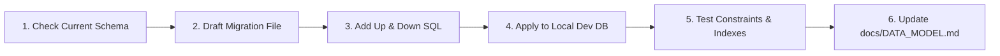

# Database Management Skill (`database-management`)

Use this skill when defining database schemas, creating migrations, adding table indexes, writing SQL transactions, or troubleshooting persistence queries for SocietyClean.

---

## 1. Prime Database Rules

1. **Zero Destructive Migration Commands:** Never execute `DROP TABLE`, `TRUNCATE`, or `db push --force-reset` on environments containing real or test data without explicit human approval.
2. **Schema Reference Document:** Always align modifications with [`docs/DATA_MODEL.md`](file:///f:/society%20waste%20mangement/docs/DATA_MODEL.md). If a column is added or altered, update the documentation synchronously.
3. **Mandatory Multi-Tenant Scoping:** Every business entity (`complaints`, `users`, `collection_schedules`) MUST contain a `society_id UUID NOT NULL REFERENCES societies(id)`.
4. **Soft Deletes for Business Records:** For complaints, use soft deletion (`deleted_at TIMESTAMPTZ NULL`). Hard deletes destroy audit trails required for society management disputes.

---

## 2. Migration Discipline & Workflow

When updating database structures, follow this sequence:



- **Reversible Migrations:** Every migration must provide both an `up` transition and an equivalent non-destructive `down` rollback script.
- **Data Type Consistency:**
  - Identifiers: `UUID` (Primary keys use `gen_random_uuid()` or ULID).
  - Timestamps: Always use `TIMESTAMPTZ` with timezone (default `NOW()`).
  - Monetary / Counts: Integers or Numeric; never floating point.
  - Enums: Store as uppercase strings with check constraints or native database ENUMs.

---

## 3. Indexing & Query Performance Checklist

Ensure critical query paths have corresponding indexes:

- [ ] `complaints(society_id, status)`: For manager filtered dashboard queries.
- [ ] `complaints(resident_id)`: For "My Complaints" list.
- [ ] `complaints(assigned_to_user_id, status)`: For staff mobile task queue.
- [ ] `complaints(reference_number)`: `UNIQUE INDEX` for $O(1)$ ticket lookup.
- [ ] `users(email)`: `UNIQUE INDEX` for login lookups.
- [ ] `status_history(complaint_id, created_at ASC)`: For chronological stepper rendering.

---

## 4. Transactional Integrity for State Transitions

Status updates and assignment changes must always execute inside an atomic database transaction:

```sql
BEGIN;
  -- 1. Update the complaint record
  UPDATE complaints
  SET status = 'RESOLVED',
      resolved_at = NOW(),
      resolution_photo_url = :photoUrl,
      resolution_notes = :notes,
      updated_at = NOW()
  WHERE id = :complaintId AND society_id = :societyId;

  -- 2. Append immutable audit log
  INSERT INTO status_history (complaint_id, from_status, to_status, changed_by_user_id, notes, created_at)
  VALUES (:complaintId, 'IN_PROGRESS', 'RESOLVED', :staffUserId, :notes, NOW());
COMMIT;
```
If any step fails, roll back the transaction completely to prevent state divergence.
