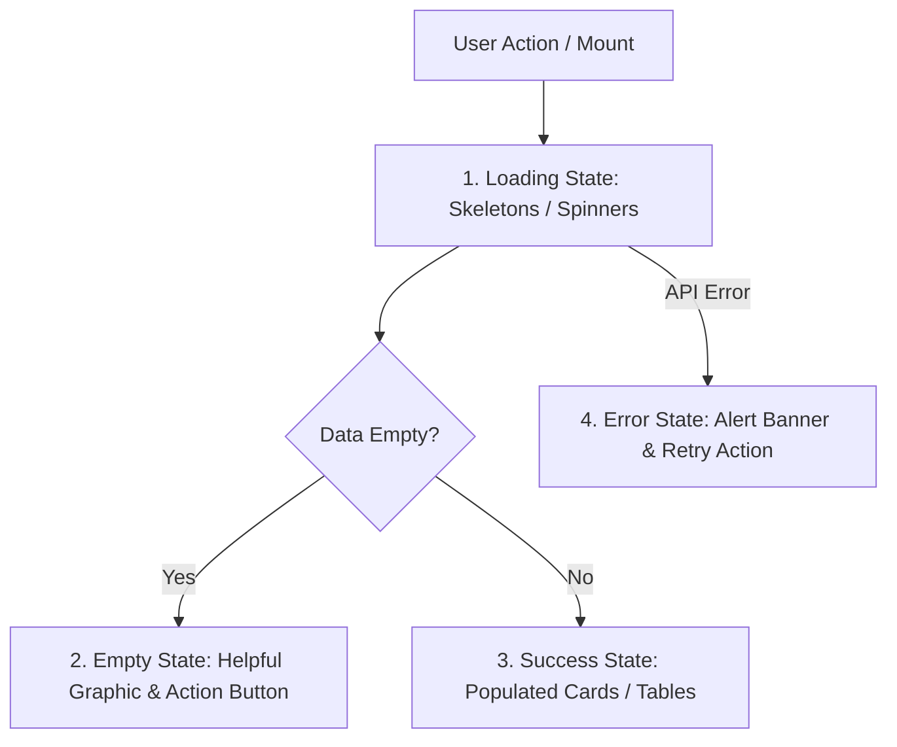

# Frontend Development Skill (`frontend-development`)

Use this skill when developing, refactoring, or testing client-side user interfaces, React components, forms, navigation structures, and responsive layouts across SocietyClean.

---

## 1. Visual & Architectural Foundation

- **Design Tokens:** Always consume CSS custom properties defined in `src/client/styles/tokens.css` (Forest Green `#1b4332`, Mint `#52b788`, Neutral `#f8fafc`).
- **No Heavy CSS Frameworks:** Use Vanilla CSS with scoped styles or CSS modules. Do not inject Tailwind or Bootstrap unless explicitly requested.
- **Mobile-First Responsiveness:**
  - Phone: Viewports `< 768px` (single column, bottom navigation bar, tap targets $\ge 44 \times 44\text{px}$).
  - Tablet: `768px - 1024px` (adaptive 2-column layout).
  - Desktop: `> 1024px` (sidebar navigation, data grids, multi-pane drawers).

---

## 2. Standard State Handling Protocol

Every UI component fetching or mutating data must explicitly implement 4 distinct visual states:

1. **Loading State:** Render CSS skeleton loaders matching the target layout; avoid jarring blank screens.
2. **Empty State:** Provide an illustration/icon, clear explanation (e.g. "No active waste complaints in your wing"), and an action button ("Report New Issue").
3. **Error State:** Display an accessible alert banner with a user-friendly error message and a "Retry" button.
4. **Success State:** Instant visual feedback (toast notification or animated confirmation badge).

---

## 3. Accessible Form Validation & Submissions

- **Labels & Hints:** Always connect form `<label>` to `<input>` with matching `id` and `htmlFor`.
- **Inline Validation:** Validate inputs on blur and form submit. Highlight invalid fields with `aria-invalid="true"` and display an error message tied via `aria-describedby`.
- **Image Previews:** When a resident selects a photo to upload:
  - Validate client-side that file size $\le 5\text{MB}$.
  - Validate MIME type is `image/jpeg`, `image/png`, or `image/webp`.
  - Generate an instant blob preview (`URL.createObjectURL(file)`).
  - Provide a "Remove / Replace" button before submission.
- **Prevent Double Submissions:** Disable submit buttons and display a spinner while async requests are active.

---

## 4. Component Structure & Reusability

Organize components under `src/client/components/`:
- `common/`: `Button`, `Input`, `Select`, `Badge`, `Modal`, `Toast`, `Spinner`.
- `layout/`: `Header`, `BottomNav`, `Sidebar`, `PageContainer`.
- `complaints/`: `ComplaintCard`, `ComplaintForm`, `StatusStepper`, `PhotoViewer`.
- `dashboard/`: `MetricCard`, `FilterBar`, `ComplaintsTable`.

Avoid copy-pasting card or badge logic. Always import the shared `StatusBadge` or `ComplaintCard` component.

---

## 5. Frontend Testing Checklist

- [ ] Verify keyboard accessibility: Can all form inputs, modals, and buttons be operated using `Tab`, `Space`, and `Enter`?
- [ ] Verify mobile viewport rendering: No horizontal scrollbars at 360px viewport width.
- [ ] Verify image upload preview handles both landscape and portrait smartphone photos gracefully.
- [ ] Verify API error handling: When the backend returns HTTP 400 or 500, a toast or banner appears rather than an uncaught React crash.
