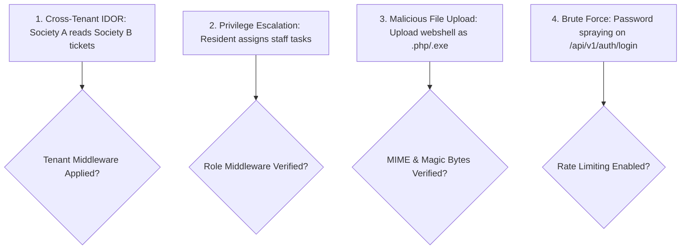

# Security Review Skill (`security-review`)

Use this skill when auditing authentication, verifying authorization policies, reviewing file upload handlers, implementing tenant isolation, and checking for OWASP Top 10 vulnerabilities in SocietyClean.

---

## 1. Threat Model & Key Attack Surfaces



---

## 2. Security Verification Checklist

### 2.1. Tenant Isolation & BOLA Prevention
- [ ] Every repository query querying `complaints`, `users`, or `schedules` includes `WHERE society_id = :sessionSocietyId`.
- [ ] Users cannot inject a custom `society_id` via request body or query parameter to access records from another housing complex.
- [ ] Direct object lookups (`GET /api/v1/complaints/:id`) verify either that `complaint.resident_id === req.userId` OR that the requester is an authorized `manager` / `staff` member for that exact society.

### 2.2. Role-Based Access Control (RBAC)
- [ ] Role enforcement happens strictly on the backend via Express middleware (`requireRole(['manager'])`).
- [ ] Staff cannot reassign complaints or modify society configurations.
- [ ] Residents cannot transition ticket states to `RESOLVED` directly.

### 2.3. Secure File Uploads
- [ ] Strict MIME-type whitelisting: Only `image/jpeg`, `image/png`, `image/webp`.
- [ ] File extensions sanitized; stored with randomized UUID filenames (preventing path traversal `../../`).
- [ ] Size cap strictly enforced at $5\text{MB}$ via Multer limits.
- [ ] Uploaded files stored outside the web root or served with `Content-Disposition: inline` and `X-Content-Type-Options: nosniff`.
- [ ] No server-side code execution in upload folders.

### 2.4. Authentication & Secret Management
- [ ] Passwords hashed with Argon2id or bcrypt (salt rounds $\ge 10$). Plaintext passwords never stored or logged.
- [ ] JWT tokens signed using high-entropy secrets ($\ge 256$ bits) loaded from environment variables.
- [ ] Zero secrets, API keys, or database credentials committed to version control.
- [ ] JWTs stored in HTTP-only, secure, SameSite cookies or sanitized Authorization headers.

### 2.5. Rate Limiting & Denial of Service Protection
- [ ] Auth endpoints (`/api/v1/auth/login`, `/register`) limited to max 5 attempts per minute per IP.
- [ ] General API routes limited to max 100 requests per 15 minutes.
- [ ] Helmet middleware configured for HSTS, Clickjacking protection (`X-Frame-Options: DENY`), and MIME sniffing prevention.

---

## 3. Security Regression Testing Commands

When implementing security tests, run:
```bash
# Execute security test suite verifying BOLA and RBAC
npm run test:security
```
Ensure tests cover:
1. Resident querying foreign society complaint (must return 404/403).
2. Unauthenticated user posting a complaint (must return 401).
3. Resident attempting manager endpoint `/api/v1/complaints/:id/assign` (must return 403).
4. Uploading a `.sh` or `.exe` file (must return 415/400).
