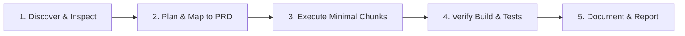

# Global Agent Instructions (`AGENTS.md`)

Welcome to **SocietyClean — Society Waste Management Portal**. This file serves as the universal operating standard for all AI coding agents, subagents, and automated developer tools working across this codebase.

---

## 1. Prime Directives for Coding Agents

1. **Read Specifications First**: Before implementing any feature, bug fix, or refactor, always read [`docs/PRD.md`](file:///f:/society%20waste%20mangement/docs/PRD.md) and cross-reference feature IDs (e.g., `FR-001`, `FR-002`).
2. **Consult Associated Skills**: Read the relevant domain skill in `.agents/skills/` (e.g., `frontend-development`, `backend-api`, `database-management`) prior to editing corresponding codebases.
3. **Inspect Before Modifying**: Never assume directory structures, schema definitions, or installed packages. Inspect existing files, package manifests, and configuration before taking action.
4. **Preserve Working Architecture**: Respect established naming conventions, design tokens, directory structures, and architectural boundaries. Do not rewrite working modules or replace frameworks without explicit documented technical justification in [`docs/DECISIONS.md`](file:///f:/society%20waste%20mangement/docs/DECISIONS.md).
5. **No Speculative or Dummy Implementations**: Never create stubbed mock APIs when a real data contract is specified. Provide robust error handling, schema validations, and realistic domain fixtures.
6. **Zero Hardcoded Secrets**: Never commit passwords, JWT secrets, database connection strings, or cloud storage keys. Always consume environment variables via validated configuration loaders.
7. **Strict Multi-Tenant Society Isolation**: All database queries, API handlers, cache keys, and file paths must strictly isolate data by `society_id`. Cross-tenant data leaks are critical security vulnerabilities.
8. **Never Falsify Test or Build Results**: Never claim a test passed, lint passed, or build succeeded unless the command was actually executed and exited with code `0`. If tests fail, report the exact error output and address it.
9. **Update Documentation Synchronously**: When schemas, routes, configuration flags, or dependencies change, update [`docs/PRD.md`](file:///f:/society%20waste%20mangement/docs/PRD.md), [`docs/API_SPECIFICATION.md`](file:///f:/society%20waste%20mangement/docs/API_SPECIFICATION.md), and [`docs/CHANGELOG.md`](file:///f:/society%20waste%20mangement/docs/CHANGELOG.md).

---

## 2. Project Overview & Current Repository State

- **Project Name**: SocietyClean (Society Waste Management Portal)
- **Repository Path**: `f:/society waste mangement`
- **Inspected State**: Greenfield / Initial Setup. As of initial project onboarding (October 2026), the repository has been initialized with the foundational architecture, documentation, and skill definitions. No legacy code exists to be deprecated.
- **Architectural Reference**: See [`docs/ARCHITECTURE.md`](file:///f:/society%20waste%20mangement/docs/ARCHITECTURE.md) for stack decisions and folder organization.

---

## 3. Agent Workflow Protocol

For any task assigned to an agent, adhere to the following 5-phase loop:

### Phase 1: Discover & Inspect
- Inspect existing files, schema files, and package manifests.
- Verify whether dependencies are installed before importing them.
- Check active environment configurations in `.env.example`.

### Phase 2: Plan & Map to PRD
- Identify the explicit Feature ID (`FR-xxx`) or Acceptance Criteria being addressed.
- Consult the relevant skill file under `.agents/skills/<skill-name>/SKILL.md`.
- Formulate a stepwise execution plan with clear rollback points.

### Phase 3: Execute in Minimal, Focused Chunks
- Write modular, idiomatic code adhering to TypeScript/JavaScript and CSS guidelines.
- Enforce validation at the entry points (e.g., Zod, Joi, or native schema validators).
- Maintain UI design tokens: Forest green (`#1b4332`), Mint accent (`#2d6a4f` / `#52b788`), crisp neutral whites/grays.

### Phase 4: Verify Build & Tests
- Execute type checking and linting.
- Run unit/integration tests covering happy paths, edge cases, and unauthorized access attempts.
- Verify responsive layout across mobile (<768px) and desktop (>1024px) viewport configurations.

### Phase 5: Document & Report
- Add entries to [`docs/CHANGELOG.md`](file:///f:/society%20waste%20mangement/docs/CHANGELOG.md).
- Document any schema modifications in [`docs/DATA_MODEL.md`](file:///f:/society%20waste%20mangement/docs/DATA_MODEL.md).
- In the final response, explicitly report:
  1. Files created or modified
  2. Tests and commands executed
  3. Verification outcome
  4. Identified risks or pending decisions

---

## 4. Key Documentation Index

| Resource | Path | Description |
| :--- | :--- | :--- |
| **Product Requirements (PRD)** | [`docs/PRD.md`](file:///f:/society%20waste%20mangement/docs/PRD.md) | Single Source of Truth for product scope, features, and workflows |
| **System Architecture** | [`docs/ARCHITECTURE.md`](file:///f:/society%20waste%20mangement/docs/ARCHITECTURE.md) | Technical stack, layer boundaries, and deployment topology |
| **API Specification** | [`docs/API_SPECIFICATION.md`](file:///f:/society%20waste%20mangement/docs/API_SPECIFICATION.md) | REST endpoint contracts, payloads, status codes, and authorization |
| **Data Model & Schemas** | [`docs/DATA_MODEL.md`](file:///f:/society%20waste%20mangement/docs/DATA_MODEL.md) | Relational/Document schemas, indexes, and integrity constraints |
| **Implementation Roadmap** | [`docs/IMPLEMENTATION_ROADMAP.md`](file:///f:/society%20waste%20mangement/docs/IMPLEMENTATION_ROADMAP.md) | Phased execution milestones from MVP1 to SaaS scaling |
| **Test Plan** | [`docs/TEST_PLAN.md`](file:///f:/society%20waste%20mangement/docs/TEST_PLAN.md) | Comprehensive test matrix, coverage criteria, and QA checklists |
| **Architectural Decisions** | [`docs/DECISIONS.md`](file:///f:/society%20waste%20mangement/docs/DECISIONS.md) | ADR records explaining rationale, alternatives, and trade-offs |
| **Project Changelog** | [`docs/CHANGELOG.md`](file:///f:/society%20waste%20mangement/docs/CHANGELOG.md) | Reverse-chronological record of codebase modifications |

---

## 5. Security & Isolation Invariants

- **Multi-Tenancy**: Every complaint, user, schedule, and log belongs to a specific `society_id`. An authenticated resident or manager from Society A must never access or manipulate records from Society B.
- **Role Permissions**: Role enforcement occurs strictly on the server:
  - `resident`: Can create complaints, view own complaints, view society collection schedule.
  - `manager`: Can view all complaints in their society, assign tasks, update complaint status, manage collection schedules.
  - `staff`: Can view assigned tasks, update work status, upload completion evidence.
  - `platform_admin`: Superadmin for cross-society provisioning and billing (future MVP2/SaaS).
- **File Upload Guardrails**: Only image MIME types (`image/jpeg`, `image/png`, `image/webp`) are accepted. Strict size limits (max 5MB) and filename sanitization must be enforced. Stored images must never execute as server-side scripts.
