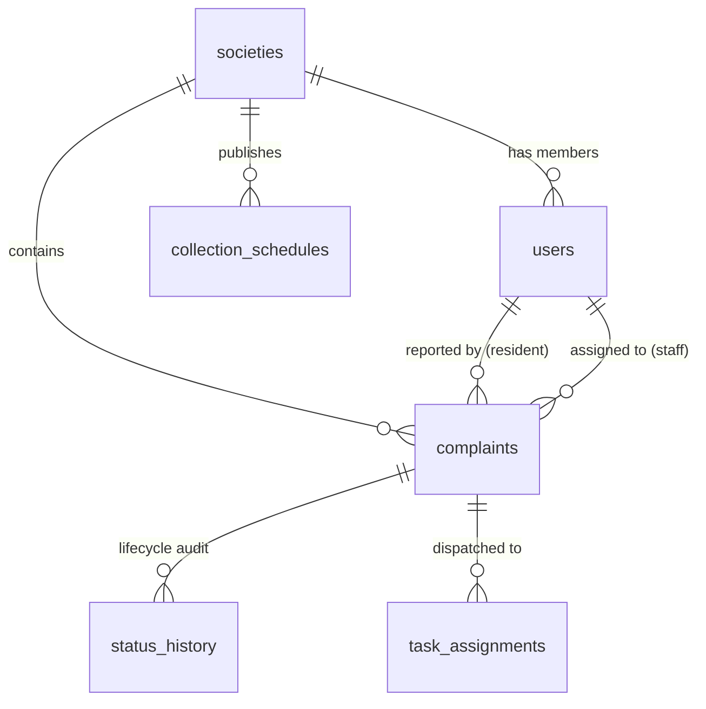

# Data Model Specification

# SocietyClean — Society Waste Management Portal

**Version:** 1.0.0  
**Status:** Approved  
**Last Updated:** October 2026  
**Related Documents:** [`docs/PRD.md`](file:///f:/society%20waste%20mangement/docs/PRD.md), [`docs/ARCHITECTURE.md`](file:///f:/society%20waste%20mangement/docs/ARCHITECTURE.md)

---

## 1. Entity-Relationship Overview



---

## 2. Table & Collection Definitions

### 2.1. `societies` Table
Stores housing societies, apartment complexes, or residential welfare associations.

| Column Name | Data Type | Nullable | Default | Constraints / Description |
| :--- | :--- | :---: | :---: | :--- |
| `id` | `UUID` | No | `gen_random_uuid()` | Primary Key |
| `name` | `VARCHAR(255)` | No | - | Full legal/display name of society |
| `code` | `VARCHAR(50)` | No | - | Unique registration join code (e.g. `GREEN-VISTA-01`) |
| `address` | `TEXT` | No | - | Physical postal address |
| `city` | `VARCHAR(100)` | No | - | City name |
| `wings_config` | `JSONB` | No | `'[]'::jsonb` | Array of wings/towers (e.g., `["Wing A", "Wing B", "Wing C"]`) |
| `floors_per_wing`| `INTEGER` | Yes | `10` | Average floors count for smart location selectors |
| `is_active` | `BOOLEAN` | No | `true` | Platform active flag |
| `created_at` | `TIMESTAMPTZ` | No | `NOW()` | Timestamp created |
| `updated_at` | `TIMESTAMPTZ` | No | `NOW()` | Timestamp updated |

- **Indexes:**
  - `societies_code_uk` (`UNIQUE (code)`)
  - `societies_city_idx` (`INDEX (city)`)

---

### 2.2. `users` Table
Stores all system actors: Residents, Society Managers, Housekeeping Staff, and Superadmins.

| Column Name | Data Type | Nullable | Default | Constraints / Description |
| :--- | :--- | :---: | :---: | :--- |
| `id` | `UUID` | No | `gen_random_uuid()` | Primary Key |
| `society_id` | `UUID` | Yes | `NULL` | Foreign Key $\rightarrow$ `societies(id)` (NULL for Platform Admin) |
| `full_name` | `VARCHAR(150)` | No | - | User display name |
| `email` | `VARCHAR(255)` | No | - | Unique login email |
| `password_hash`| `VARCHAR(255)` | No | - | Argon2id / Bcrypt password hash |
| `role` | `VARCHAR(30)` | No | `'resident'` | Enum: `resident`, `manager`, `staff`, `platform_admin` |
| `phone` | `VARCHAR(20)` | Yes | `NULL` | Phone number for emergency alerts |
| `employee_id` | `VARCHAR(50)` | Yes | `NULL` | Staff employee or contractor identifier |
| `wing` | `VARCHAR(50)` | Yes | `NULL` | Resident wing (e.g., `Wing B`) |
| `flat_number` | `VARCHAR(50)` | Yes | `NULL` | Resident flat/unit (e.g., `B-402`) |
| `is_active` | `BOOLEAN` | No | `true` | Account active flag |
| `created_at` | `TIMESTAMPTZ` | No | `NOW()` | Timestamp created |
| `updated_at` | `TIMESTAMPTZ` | No | `NOW()` | Timestamp updated |

- **Indexes:**
  - `users_email_uk` (`UNIQUE (email)`)
  - `users_society_id_idx` (`INDEX (society_id)`)
  - `users_role_society_idx` (`INDEX (society_id, role)`)

---

### 2.3. `complaints` Table
The central transactional record capturing waste reports, locations, imagery, and current operational status.

| Column Name | Data Type | Nullable | Default | Constraints / Description |
| :--- | :--- | :---: | :---: | :--- |
| `id` | `UUID` | No | `gen_random_uuid()` | Primary Key |
| `society_id` | `UUID` | No | - | Foreign Key $\rightarrow$ `societies(id)` (Tenant key) |
| `reference_number` | `VARCHAR(30)` | No | - | Unique human ID: `SC-YYYYMMDD-XXXX` |
| `resident_id` | `UUID` | No | - | Foreign Key $\rightarrow$ `users(id)` (Reporter) |
| `category` | `VARCHAR(50)` | No | - | Enum: `OVERFLOWING_BIN`, `MISSED_COLLECTION`, `UNCLEAN_ROOM`, `BAD_ODOUR`, `SEGREGATION_VIOLATION`, `OTHER` |
| `description` | `TEXT` | No | - | Detailed description |
| `wing` | `VARCHAR(50)` | No | - | Location: Wing/Tower |
| `floor_location`| `VARCHAR(100)` | No | - | Location: Floor or common area descriptor |
| `photo_url` | `VARCHAR(500)` | Yes | `NULL` | Relative or S3 URL of initial incident photo |
| `status` | `VARCHAR(30)` | No | `'PENDING'` | Enum: `PENDING`, `IN_PROGRESS`, `RESOLVED`, `REOPENED`, `CANCELLED` |
| `assigned_to_user_id`| `UUID` | Yes | `NULL` | Foreign Key $\rightarrow$ `users(id)` (Staff member assigned) |
| `resolution_photo_url`| `VARCHAR(500)` | Yes | `NULL` | Image URL of resolved area |
| `resolution_notes`| `TEXT` | Yes | `NULL` | Notes added upon resolution |
| `resolved_at` | `TIMESTAMPTZ` | Yes | `NULL` | Timestamp marked resolved |
| `deleted_at` | `TIMESTAMPTZ` | Yes | `NULL` | Soft deletion timestamp |
| `created_at` | `TIMESTAMPTZ` | No | `NOW()` | Submission timestamp |
| `updated_at` | `TIMESTAMPTZ` | No | `NOW()` | Last mutation timestamp |

- **Indexes:**
  - `complaints_reference_number_uk` (`UNIQUE (reference_number)`)
  - `complaints_society_status_idx` (`INDEX (society_id, status)`)
  - `complaints_resident_idx` (`INDEX (resident_id)`)
  - `complaints_assigned_staff_idx` (`INDEX (assigned_to_user_id, status)`)
  - `complaints_created_at_idx` (`INDEX (created_at DESC)`)

---

### 2.4. `status_history` Table
Immutable audit trail capturing all state transitions, who initiated them, and contextual notes.

| Column Name | Data Type | Nullable | Default | Constraints / Description |
| :--- | :--- | :---: | :---: | :--- |
| `id` | `UUID` | No | `gen_random_uuid()` | Primary Key |
| `complaint_id` | `UUID` | No | - | Foreign Key $\rightarrow$ `complaints(id)` ON DELETE CASCADE |
| `from_status` | `VARCHAR(30)` | Yes | `NULL` | Previous status state |
| `to_status` | `VARCHAR(30)` | No | - | New status state |
| `changed_by_user_id` | `UUID` | No | - | Foreign Key $\rightarrow$ `users(id)` |
| `notes` | `TEXT` | Yes | `NULL` | Reason or comment accompanying transition |
| `created_at` | `TIMESTAMPTZ` | No | `NOW()` | Timestamp of transition |

- **Indexes:**
  - `status_history_complaint_idx` (`INDEX (complaint_id, created_at ASC)`)

---

### 2.5. `task_assignments` Table
Tracks dispatch requests from managers to housekeeping personnel.

| Column Name | Data Type | Nullable | Default | Constraints / Description |
| :--- | :--- | :---: | :---: | :--- |
| `id` | `UUID` | No | `gen_random_uuid()` | Primary Key |
| `complaint_id` | `UUID` | No | - | Foreign Key $\rightarrow$ `complaints(id)` |
| `assigned_by_user_id` | `UUID` | No | - | Foreign Key $\rightarrow$ `users(id)` (Manager) |
| `assigned_to_user_id` | `UUID` | No | - | Foreign Key $\rightarrow$ `users(id)` (Staff) |
| `instructions` | `TEXT` | Yes | `NULL` | Specific manager directives |
| `is_active` | `BOOLEAN` | No | `true` | True until reassigned or completed |
| `assigned_at` | `TIMESTAMPTZ` | No | `NOW()` | Timestamp dispatched |

---

### 2.6. `collection_schedules` Table
Defines weekly scheduled pickups for different waste streams.

| Column Name | Data Type | Nullable | Default | Constraints / Description |
| :--- | :--- | :---: | :---: | :--- |
| `id` | `UUID` | No | `gen_random_uuid()` | Primary Key |
| `society_id` | `UUID` | No | - | Foreign Key $\rightarrow$ `societies(id)` |
| `waste_category` | `VARCHAR(50)` | No | - | Enum: `WET_ORGANIC`, `DRY_RECYCLABLE`, `E_WASTE`, `HAZARDOUS`, `GARDEN_DEBRIS` |
| `days_of_week` | `JSONB` | No | - | Array of day abbreviations: `["MON", "WED", "FRI"]` |
| `start_time` | `VARCHAR(10)` | No | - | Start time (e.g. `'08:00'`) |
| `end_time` | `VARCHAR(10)` | No | - | End time (e.g. `'10:00'`) |
| `instructions` | `TEXT` | Yes | `NULL` | Resident handling tips |
| `disposal_location` | `TEXT` | Yes | `NULL` | Specific drop-off location or chute area |
| `is_active` | `BOOLEAN` | No | `true` | Active schedule flag |
| `created_at` | `TIMESTAMPTZ` | No | `NOW()` | Timestamp created |

---

## 3. Data Integrity & Isolation Rules

1. **Mandatory Foreign Keys:** No dangling complaints or orphan status logs. Cascade deletes apply strictly to audit logs if a complaint is purged, but complaints use soft-deletion (`deleted_at`).
2. **Society Isolation:** Every query on `complaints` or `collection_schedules` must filter by `society_id`.
3. **Reference Number Generation Formula:**
   ```sql
   -- Reference format: SC-YYYYMMDD-XXXX
   -- Example: SC-20261028-0001
   ```
   Generated using a transaction-safe sequence or cryptographically safe random hex truncated to 4 characters with collision-retry logic.
