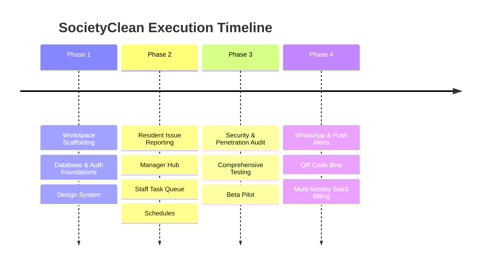

# Implementation Roadmap

# SocietyClean — Society Waste Management Portal

**Version:** 1.0.0  
**Status:** Approved  
**Related Documents:** [`docs/PRD.md`](file:///f:/society%20waste%20mangement/docs/PRD.md), [`docs/ARCHITECTURE.md`](file:///f:/society%20waste%20mangement/docs/ARCHITECTURE.md), [`docs/TEST_PLAN.md`](file:///f:/society%20waste%20mangement/docs/TEST_PLAN.md)

---

## 1. Roadmap Overview & Phasing

---

## 2. Phase Breakdown

### Phase 1: Foundations & Core Infrastructure (Milestone M1)
**Goal:** Establish clean repository skeleton, TypeScript contracts, database migrations, authentication, and core design tokens.

- [x] **M1.1: Project Scaffolding & Tooling**
  - Initialize `package.json` with Node.js/Express + React (Vite).
  - Setup test runner (Vitest) with Supertest.
- [x] **M1.2: Design Tokens & CSS Architecture**
  - Implement `tokens.css` with Forest Green (`#1b4332`), Mint (`#52b788`), and neutral palettes.
  - Implement responsive base layout, typography, and standard CSS reset.
- [x] **M1.3: Database Schemas & Migrations**
  - Create SQLite schema for `societies`, `users`, `complaints`, `status_history`, `collection_schedules`.
  - Add database seed script creating demo society with Resident, Manager, and Staff accounts.
- [x] **M1.4: Authentication & Tenant Middleware (`FR-001`)**
  - Implement `/api/v1/auth/register`, `/api/v1/auth/login`, and `/api/v1/auth/me`.
  - Build `authMiddleware` (JWT validation) and RBAC role scoping.

*Definition of Done for M1:* **COMPLETE & VERIFIED**.

---

### Phase 2: MVP 1 Core Feature Implementation (Milestone M2)
**Goal:** Complete all P0 and P1 functional requirements defined in `docs/PRD.md`.

- [x] **M2.1: Resident Issue Reporting & File Uploads (`FR-002`, `FR-003`, `FR-004`)**
  - Implement `POST /api/v1/complaints` with Multer file validation (5MB max, image types only).
  - Implement reference generator (`SC-YYYYMMDD-XXXX`).
  - Build mobile-optimized complaint form with Category selector, Wing/Floor dropdowns, and image preview.
- [x] **M2.2: Resident Ticket History & Tracking Stepper (`FR-005`)**
  - Implement `GET /api/v1/complaints/my`.
  - Build responsive ticket card list with visual state progression (`Pending` $\rightarrow$ `In Progress` $\rightarrow$ `Resolved`).
  - Build complaint detail modal showing timestamps and before/after photos.
- [x] **M2.3: Society Manager Operations Hub (`FR-006`, `FR-007`)**
  - Implement `GET /api/v1/complaints` with query filtering (status, category, wing, date).
  - Implement `GET /api/v1/analytics/overview` calculating KPIs (Active, Resolved, Overdue).
  - Build Manager Dashboard UI with summary cards, search filter toolbar, and complaints table.
- [x] **M2.4: Staff Task Queue & Resolution Flow (`FR-008`, `FR-009`, `FR-010`)**
  - Implement `PATCH /api/v1/complaints/:id/assign` for managers.
  - Implement `POST /api/v1/complaints/:id/resolve` with optional resolution image upload.
  - Build mobile-optimized Staff Task Queue UI with "Mark Resolved" drawer.
- [x] **M2.5: Waste Collection Schedule (`FR-011`)**
  - Implement `GET /api/v1/schedules` and manager update API.
  - Build resident weekly schedule calendar and today's pickup reminder banner.

*Definition of Done for M2:* **COMPLETE & VERIFIED**. Full end-to-end lifecycle verified via automated integration tests and UI workflows.

---

### Phase 3: Verification, Hardening & Society Pilot (Milestone M3)
**Goal:** Comprehensive testing, security audit, and deployment for a real-world residential pilot.

- [ ] **M3.1: Automated Test Suite Execution**
  - Unit tests covering state machine transitions, JWT extraction, and input validation.
  - Integration tests verifying multi-tenant isolation (preventing Society A from querying Society B).
- [ ] **M3.2: Security Hardening**
  - Rate limiting on auth and complaint submission routes.
  - Security headers verification (Helmet).
  - Sanitize file uploads and verify no executable scripts can be uploaded or served.
- [ ] **M3.3: Pilot Society Deployment**
  - Deploy to production staging environment (e.g. Render / Railway / Vercel + Neon PostgreSQL).
  - Onboard 1 real housing society (50-100 flats) for 14-day operational beta.

*Definition of Done for M3:* All automated tests pass with 0 regressions, and pilot society managers resolve real tickets in under 2 hours average MTTR.

---

### Phase 4: MVP 2 & SaaS Expansion (Milestone M4)
**Goal:** Automation, messaging, and multi-tenant self-service scaling.

- [ ] WhatsApp & SMS notification webhooks for status updates.
- [ ] QR code generation for garbage rooms and chutes (pre-fills Wing & Floor on scan).
- [ ] Resident satisfaction rating (1 to 5 stars) upon ticket resolution.
- [ ] Superadmin dashboard for self-service society onboarding and subscription payments.
