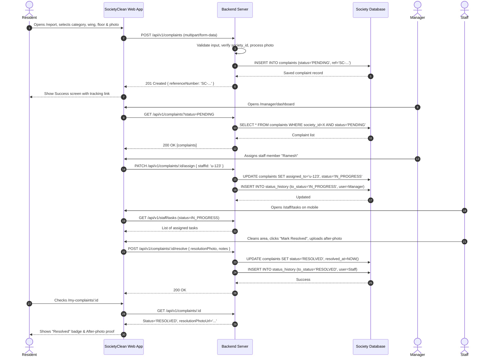
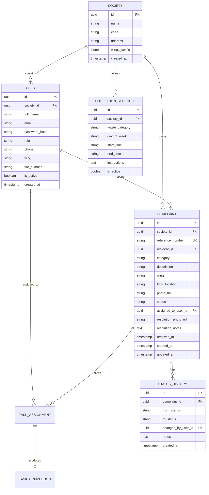
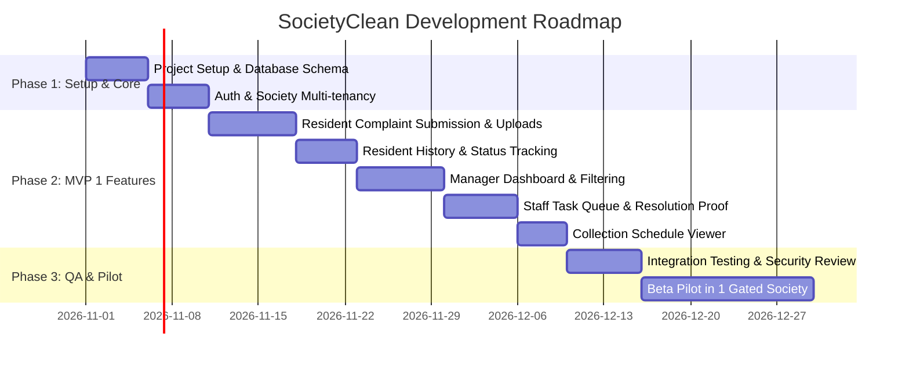

# Product Requirements Document (PRD)

# SocietyClean — Society Waste Management Portal

**Document Version:** 1.0.0  
**Status:** Approved for MVP 1 Implementation  
**Last Updated:** October 2026  
**Target Platform:** Responsive Web Application (Mobile-First & Desktop)  

---

## Table of Contents
1. [A. Product Overview](#a-product-overview)
2. [B. Product Scope](#b-product-scope)
3. [C. MVP 1 Functional Requirements](#c-mvp-1-functional-requirements)
4. [D. User Roles and Permissions](#d-user-roles-and-permissions)
5. [E. User Stories](#e-user-stories)
6. [F. User Workflows](#f-user-workflows)
7. [G. UI/UX Requirements](#g-uiux-requirements)
8. [H. Data Model Summary](#h-data-model-summary)
9. [I. Technical Architecture Overview](#i-technical-architecture-overview)
10. [J. API Specification Summary](#j-api-specification-summary)
11. [K. Security and Privacy](#k-security-and-privacy)
12. [L. Non-Functional Requirements](#l-non-functional-requirements)
13. [M. Testing and Acceptance](#m-testing-and-acceptance)
14. [N. Roadmap and Risks](#n-roadmap-and-risks)
15. [O. Decisions and Open Questions](#o-decisions-and-open-questions)

---

## A. Product Overview

### 1. Product Name & Description
**SocietyClean** is a modern, responsive residential waste management and housekeeping coordination portal designed for residential housing societies and apartment complexes. It centralizes waste incident reporting, housekeeping dispatch, collection schedule broadcasting, and cleanup verification into a transparent, accountable platform.

### 2. Problem Statement
Urban housing societies struggle with waste management due to informal communication channels (WhatsApp groups, phone calls, and word-of-mouth). This causes:
- **Unaddressed Hazards:** Overflowing garbage bins, foul odors, and unclean disposal rooms linger for hours or days without accountability.
- **Waste Segregation Breakdown:** Poor resident awareness or lack of collection consistency leads to mixed wet/dry waste penalties from municipal authorities.
- **Lack of Tracking & Proof:** Society managers lack visibility into whether housekeeping staff completed cleanups or if complaints were resolved satisfactorily.
- **Resident Frustration:** Residents cannot check the status of reported issues or view up-to-date waste collection timetables.

### 3. Proposed Solution
SocietyClean provides an intuitive, web-based operating system for housing societies:
- **For Residents:** A 30-second mobile complaint submission form with image uploads, real-time ticket tracking, and waste segregation collection timetables.
- **For Society Managers:** A centralized operations dashboard with ticket assignment, housekeeping analytics, SLA tracking, and schedule broadcasts.
- **For Housekeeping Staff:** A clear mobile-friendly queue of assigned cleanup tasks with photo-evidence completion workflows.
- **For Society Administrators:** Society-level configurations, wing/floor topologies, and audit logs.

### 4. Product Vision
To become the premier operational backbone for green, zero-waste housing societies across urban residential communities, driving compliance, environmental hygiene, and resident delight.

### 5. Business Objectives
- **Phase 1 (MVP 1):** Deploy a single-society operational pilot with >90% resident satisfaction and >50% reduction in average ticket resolution time.
- **Phase 2 (MVP 2):** Introduce automated WhatsApp/SMS notifications, QR-code bin scanning, and municipal compliance reporting.
- **Phase 3 (SaaS Scaling):** Multi-society multi-tenant SaaS subscription priced per flat/unit per month (B2B model targeting Resident Welfare Associations).

### 6. Target Customers & Market
- Cooperative Housing Societies (CHSs)
- Gated apartment communities (100 to 2,000+ units)
- Facility management firms managing residential complexes
- Township and residential welfare associations (RWAs)

### 7. User Personas

| Persona | Role | Primary Goal | Key Pain Point |
| :--- | :--- | :--- | :--- |
| **Rajesh Sharma (Resident)** | Flat Owner / Tenant | Quickly report an overflowing garbage chute on his floor and know when it gets cleared. | Messages posted in society WhatsApp groups get buried and ignored. |
| **Anita Deshmukh (Society Secretary / Manager)** | Operations Manager | Monitor all active waste issues, assign work to housekeeping contractors, and track resolution metrics. | No objective evidence of whether housekeeping contractors performed scheduled cleanups. |
| **Ramesh Kumar (Housekeeping Supervisor / Staff)** | Ground Execution Staff | Receive unambiguous task locations (Wing, Floor, Bin ID) and submit proof of resolution. | Verbal instructions are vague; gets blamed for unassigned or delayed tasks. |
| **SaaS Administrator (Superadmin)** | Platform Administrator | Provision new societies, monitor system health, and oversee billing subscriptions. | Manual onboarding without tenant data isolation creates compliance and scaling bottlenecks. |

### 8. Value Proposition
- **Accountability:** Transparent lifecycle from report to photo-verified resolution.
- **Operational Speed:** Average issue resolution time dropped from 24+ hours to <2 hours.
- **Civic Compliance:** Clear segregation schedules reduce municipal fines for mixed waste.
- **Zero App Store Friction:** Progressive, highly responsive web application accessible from any smartphone or desktop browser.

### 9. Success Metrics (KPIs)
- **Time to First Response:** <15 minutes from submission to manager review/assignment.
- **Mean Time to Resolution (MTTR):** <2 hours for standard waste incidents.
- **Adoption Rate:** >70% of registered flats active within 60 days of society rollout.
- **Reopen Rate:** <5% of resolved complaints reopened due to unsatisfactory cleanup.

---

## B. Product Scope

### 1. MVP 1 (Mandatory Initial Release)
- Role-based authentication (Resident, Manager, Staff).
- Resident incident reporting with photo upload, location selectors, and automated ticket IDs (`SC-YYYYMMDD-XXXX`).
- Issue categorization (Overflowing Bin, Missed Pickup, Unclean Garbage Room, Bad Odour, Waste Segregation, Other).
- Resident complaint history and visual status tracker (Pending $\rightarrow$ In Progress $\rightarrow$ Resolved).
- Society Manager dashboard with metrics, status filter, category filter, and location filter.
- Manager task assignment to housekeeping staff members.
- Staff task completion workflow with optional resolution photo evidence.
- Society waste collection schedule viewer (Wet, Dry, E-Waste, Hazardous).
- Fully responsive mobile & desktop web interface adhering to the Forest Green/Mint design system.

### 2. MVP 2 (Post-MVP Improvements)
- Real-time notifications via WebSockets or Server-Sent Events (SSE).
- Email & WhatsApp automated status alert webhooks.
- QR code placement on bins for instant, pre-filled location reporting.
- Resident satisfaction rating (1-5 stars) upon resolution.
- Exportable CSV/PDF society hygiene and contractor performance reports.

### 3. Future SaaS Platform Capabilities
- Multi-society self-service onboarding and subscription billing (Stripe / Razorpay).
- Integration with smart IoT bin level sensors.
- AI-assisted waste image classification (verifying segregation compliance automatically).
- Municipal waste truck GPS tracking integration.

---

## C. MVP 1 Functional Requirements

### FR-001: User Authentication & Role-Based Session Management
- **Feature ID:** `FR-001`
- **Description:** Secure registration and login supporting email/password authentication with JWT or secure session cookies. Users belong to a specific society and have one assigned role.
- **User Role:** Resident, Society Manager, Housekeeping Staff.
- **Priority:** Critical (P0)
- **Preconditions:** Society profile exists in database.
- **Expected Behavior:** Authenticated users receive role-scoped access. Unauthenticated users are redirected to login.
- **Acceptance Criteria:**
  - Password hashed with Argon2id or bcrypt (salt rounds $\ge 10$).
  - Server returns JWT/session containing `userId`, `role`, and `societyId`.
  - Inactive sessions expire after 7 days; logout revokes token/session.
- **Error Scenarios:** Invalid credentials return HTTP 401 with generic message; inactive accounts return HTTP 403.
- **Dependencies:** Database `users` and `societies` tables.

---

### FR-002: Resident Waste Issue Reporting
- **Feature ID:** `FR-002`
- **Description:** Mobile-first reporting form enabling residents to lodge a waste incident with category, location details, description, and an optional photograph.
- **User Role:** Resident.
- **Priority:** Critical (P0)
- **Preconditions:** Resident is authenticated and has an active unit assignment (Wing, Flat No).
- **Expected Behavior:** On submit, server validates payload, persists complaint, stores photo, generates unique reference ID, and sets status to `PENDING`.
- **Acceptance Criteria:**
  - Form requires Category, Wing, Floor/Collection Point, and Description (minimum 10 characters).
  - Photo attachment accepts JPEG/PNG/WebP up to 5MB.
  - Generates unique complaint reference code (e.g., `SC-20261028-0042`).
  - Redirects user to complaint confirmation screen with tracking link.
- **Error Scenarios:** Missing fields display inline red validation errors; oversized uploads display "Image size exceeds 5MB limit".
- **Dependencies:** `FR-001`, File upload service.

---

### FR-003: Categorization of Waste Complaints
- **Feature ID:** `FR-003`
- **Description:** Structured taxonomy for waste issues:
  1. `OVERFLOWING_BIN`: Overflowing garbage bin or chute.
  2. `MISSED_COLLECTION`: Scheduled door-to-door or floor pickup missed.
  3. `UNCLEAN_ROOM`: Refuse room, bin area, or chute lobby dirty/stained.
  4. `BAD_ODOUR`: Severe decomposing smell or pest infestation.
  5. `SEGREGATION_VIOLATION`: Mixed wet/dry garbage or improper dumping.
  6. `OTHER`: General sanitation or waste disposal concern.
- **User Role:** Resident, Manager.
- **Priority:** High (P0)
- **Preconditions:** None.
- **Expected Behavior:** Category selection dictates default urgency and displays helpful segregation tips.
- **Acceptance Criteria:** Categories stored as normalized enum values; readable labels displayed in UI.
- **Error Scenarios:** Invalid category value rejected by server validation (HTTP 400).
- **Dependencies:** None.

---

### FR-004: Unique Reference Number Generation
- **Feature ID:** `FR-004`
- **Description:** Every submitted complaint is assigned an immutable, human-readable reference number.
- **Format:** `SC-YYYYMMDD-XXXX` (where `XXXX` is a sequential or cryptographic hex/decimal string unique within the society).
- **User Role:** System.
- **Priority:** High (P0)
- **Preconditions:** Complaint created in database.
- **Expected Behavior:** Reference ID displayed in all UI views, search bars, and status updates.
- **Acceptance Criteria:** Never duplicates; indexed for $O(1)$ database lookup.
- **Error Scenarios:** Collision handling automatically retries with sequence increment.
- **Dependencies:** Database unique constraint.

---

### FR-005: Resident Complaint History & Status Tracking
- **Feature ID:** `FR-005`
- **Description:** Resident portal view showing all complaints filed by the logged-in resident with status badges and chronological timeline.
- **User Role:** Resident.
- **Priority:** High (P0)
- **Preconditions:** User is authenticated as Resident.
- **Expected Behavior:** Chronological list with tabs (`Active`, `Resolved`, `All`), showing category, date, location, thumbnail, and current status. Clicking opens details modal or page.
- **Acceptance Criteria:**
  - Displays status stepper: `Submitted` $\rightarrow$ `Under Review / Assigned` $\rightarrow$ `In Progress` $\rightarrow$ `Resolved`.
  - Shows staff resolution timestamp and resolution photo (if provided).
- **Error Scenarios:** Empty state shown if resident has lodged 0 complaints with a prominent "Report New Issue" button.
- **Dependencies:** `FR-002`, `FR-008`.

---

### FR-006: Society Manager Operational Dashboard
- **Feature ID:** `FR-006`
- **Description:** Centralized control room for society managers displaying operational metrics, pending complaints, staff status, and overdue alerts.
- **User Role:** Society Manager.
- **Priority:** Critical (P0)
- **Preconditions:** User authenticated with `manager` role for the society.
- **Expected Behavior:**
  - KPI Cards: Total Open, Pending Assignment, In Progress, Resolved Today, Overdue (>4 hrs).
  - Interactive Complaints Table with sorting, bulk actions, and quick assignment drawer.
- **Acceptance Criteria:**
  - Real-time or quick-refresh metrics calculated across current society records only.
  - Zero cross-tenant leakage of complaint counts.
- **Error Scenarios:** Failure to fetch metrics presents non-blocking alert banner with retry button.
- **Dependencies:** `FR-001`, `FR-002`, `FR-007`.

---

### FR-007: Complaint Filtering & Search
- **Feature ID:** `FR-007`
- **Description:** Multi-parameter filtering across the manager complaints view.
- **Filter Dimensions:**
  - **Status:** All, Pending, In Progress, Resolved.
  - **Category:** All, or any of the 6 categories.
  - **Location:** Wing (e.g., Wing A, Wing B), Floor range.
  - **Date Range:** Today, Past 7 Days, Past 30 Days, Custom.
  - **Search:** By Reference ID or text substring.
- **User Role:** Society Manager, Housekeeping Staff.
- **Priority:** High (P1)
- **Preconditions:** Manager/Staff view.
- **Expected Behavior:** URL query parameters update dynamically; results debounce within 250ms.
- **Acceptance Criteria:** Works correctly with combined filters; returns empty state if no records match.
- **Error Scenarios:** Malformed query parameters safely fallback to default view.
- **Dependencies:** `FR-006`.

---

### FR-008: Formal Status Lifecycle & History Audit
- **Feature ID:** `FR-008`
- **Description:** Strict state machine governing complaint progression. Every status change appends a record to `status_history`.
- **States:**
  - `PENDING`: Newly submitted, unassigned.
  - `IN_PROGRESS`: Assigned to staff or actively being addressed.
  - `RESOLVED`: Cleanup completed and verified.
  - `REOPENED`: Resident flags that the issue remains unresolved.
  - `CANCELLED`: Invalid, duplicate, or retracted ticket.
- **User Role:** Society Manager, Staff (transition to Resolved).
- **Priority:** Critical (P0)
- **Preconditions:** Valid complaint ID.
- **Expected Behavior:** State transitions strictly checked against transition rules:
  - `PENDING` $\rightarrow$ `IN_PROGRESS` | `CANCELLED`
  - `IN_PROGRESS` $\rightarrow$ `RESOLVED` | `PENDING`
  - `RESOLVED` $\rightarrow$ `REOPENED`
  - `REOPENED` $\rightarrow$ `IN_PROGRESS`
- **Acceptance Criteria:** Each transition records `from_status`, `to_status`, `changed_by_user_id`, `notes`, and `timestamp`.
- **Error Scenarios:** Invalid transition returns HTTP 422 with descriptive state error.
- **Dependencies:** `docs/DATA_MODEL.md`.

---

### FR-009: Staff Task Assignment
- **Feature ID:** `FR-009`
- **Description:** Manager selects a complaint and assigns it to an active housekeeping staff member or supervisor with optional priority notes.
- **User Role:** Society Manager.
- **Priority:** High (P1)
- **Preconditions:** Staff users exist in the society; complaint status is `PENDING` or `IN_PROGRESS`.
- **Expected Behavior:** System links `assigned_to_user_id`, moves status to `IN_PROGRESS`, and records assignment timestamp.
- **Acceptance Criteria:**
  - Manager sees a dropdown of active staff members with current pending workload count.
  - Assignment persists immediately and displays on the staff member's mobile queue.
- **Error Scenarios:** Assigning to an inactive staff member returns HTTP 400.
- **Dependencies:** `FR-001`, `FR-008`.

---

### FR-010: Staff Task Execution & Resolution Proof
- **Feature ID:** `FR-010`
- **Description:** Housekeeping staff access a mobile-optimized queue of tasks assigned to them, inspect location/instructions, and mark tasks `RESOLVED` with optional after-cleanup photo evidence.
- **User Role:** Housekeeping Staff, Society Manager.
- **Priority:** High (P1)
- **Preconditions:** Task assigned to the logged-in staff member.
- **Expected Behavior:** Staff clicks "Mark Resolved", uploads a photo showing the clean area, enters optional completion notes, and submits.
- **Acceptance Criteria:**
  - Status transitions to `RESOLVED`.
  - Resolution timestamp and resolution image URL stored in `complaints` record.
  - Resident can view both "Before" (report) and "After" (resolution) images side by side.
- **Error Scenarios:** Network disconnect during upload keeps optimistic UI state with retry mechanism.
- **Dependencies:** `FR-008`, `FR-009`.

---

### FR-011: Society Waste Collection Schedule Viewer
- **Feature ID:** `FR-011`
- **Description:** Public/Resident accessible schedule displaying weekly collection timetables categorized by waste stream:
  - **Wet / Organic Waste:** Daily (e.g., 8:00 AM - 10:00 AM).
  - **Dry / Recyclable Waste:** Mon, Wed, Fri (e.g., 10:30 AM - 12:30 PM).
  - **E-Waste & Hazardous:** 1st Saturday of each month.
  - **Garden / Debris Waste:** Bi-weekly on Tuesday.
- **User Role:** Resident, Society Manager (edit), Staff.
- **Priority:** Medium (P1)
- **Preconditions:** Society schedule records populated.
- **Expected Behavior:** Visual weekly calendar and today's active pickup banner displayed on resident home screen.
- **Acceptance Criteria:**
  - Managers can update pickup days, time windows, and instructions.
  - Residents see "Next Collection in X hours" indicator.
- **Error Scenarios:** Empty schedule displays society manager contact prompt.
- **Dependencies:** `FR-001`.

---

### FR-012: Responsive Design & Mobile Usability
- **Feature ID:** `FR-012`
- **Description:** Complete UI/UX responsive across smartphones (iOS Safari, Android Chrome, 360px+ viewport), tablets, and desktops (1920px+).
- **User Role:** All.
- **Priority:** Critical (P0)
- **Acceptance Criteria:** Touch targets $\ge 44 \times 44$px; zero horizontal overflow on mobile viewports; critical resident actions reachable with thumb navigation.

---

### FR-013: UI Feedback, States & Error Handling
- **Feature ID:** `FR-013`
- **Description:** Every asynchronous operation exhibits clear visual feedback:
  - Skeleton screens during data fetching.
  - Floating toast notifications for success/error events.
  - Contextual empty states with actionable illustrations.
  - Inline input validation with accessible ARIA error messages.
- **User Role:** All.
- **Priority:** High (P1)

---

## D. User Roles and Permissions

### 1. Role Definitions
1. **Resident (`resident`):** Apartment owners or tenants. Can report issues, track own tickets, view society schedules, and verify cleanups.
2. **Society Manager (`manager`):** Committee secretaries, facility managers, or estate officers. Full authority over society waste operations.
3. **Housekeeping Staff (`staff`):** Sanitation workers, janitors, and cleaning supervisors. Can view assigned jobs and submit completion proof.
4. **Platform Administrator (`platform_admin`):** Superuser managing multi-tenant society onboarding, platform health, and billing.

### 2. Authorization Permission Matrix

| Capability / Resource | Resident | Society Manager | Housekeeping Staff | Platform Admin |
| :--- | :---: | :---: | :---: | :---: |
| **Create Incident Complaint** | Yes | Yes | No | No |
| **View Own Complaints** | Yes | Yes | Yes (if assigned) | Yes (audit) |
| **View All Society Complaints** | No | Yes | Yes (read-only queue) | Yes |
| **Edit / Cancel Own Complaint** | Yes (if `PENDING`) | Yes | No | Yes |
| **Assign Complaint to Staff** | No | Yes | No | No |
| **Update Complaint Status** | No (can Reopen) | Yes (all states) | Yes (`RESOLVED` only) | Yes |
| **Upload Resolution Proof Photo** | No | Yes | Yes | No |
| **Reopen Resolved Complaint** | Yes (within 48 hrs) | Yes | No | No |
| **Manage Collection Schedules** | View Only | Create / Edit / Delete | View Only | Yes |
| **View Society Dashboard & Analytics** | No | Yes | No | Yes |
| **Manage Society Users & Staff** | No | Yes | No | Yes |
| **Configure Society Wings / Floors** | No | Yes | No | Yes |
| **Provision New Society Tenant** | No | No | No | Yes |

*Note: All permissions must be strictly verified on the backend API layer before executing database transactions.*

---

## E. User Stories

### US-001: Fast Waste Incident Submission
- **Story:** As a **Resident**, I want to submit a photo and location of an overflowing garbage chute from my smartphone in under 30 seconds, so that housekeeping cleans it before odours enter my apartment.
- **Acceptance Criteria:**
  - Given an authenticated resident on the complaint form,
  - When they select "Overflowing garbage bin", choose "Wing B", "Floor 4 Chute", attach a photo, and click "Submit",
  - Then a new ticket `SC-YYYYMMDD-XXXX` is generated,
  - And a green confirmation modal shows the reference number,
  - And the ticket appears immediately under the resident's "My Complaints" list.

### US-002: Resident Ticket Status Tracking
- **Story:** As a **Resident**, I want to check whether my reported issue is being worked on, so that I don't have to call the society manager or post in the WhatsApp group.
- **Acceptance Criteria:**
  - Given a logged-in resident with an active complaint,
  - When they open "My Complaints",
  - Then they see an interactive progress stepper showing whether it is Pending, Assigned, or Resolved,
  - And if Resolved, they can inspect the resolution photo submitted by the staff.

### US-003: Manager Issue Triage & Assignment
- **Story:** As a **Society Manager**, I want to see an organized queue of open waste complaints sorted by urgency and assign them to available housekeeping personnel, so that cleaning duties are distributed efficiently.
- **Acceptance Criteria:**
  - Given a manager viewing the dashboard,
  - When 3 complaints arrive with status `PENDING`,
  - Then the manager can filter by Category or Wing,
  - And click "Assign Staff", choose an active staff member from a dropdown, and save,
  - And the complaint moves to `IN_PROGRESS` with the assignee's name tagged.

### US-004: Staff Mobile Task Completion
- **Story:** As a **Housekeeping Staff Member**, I want to check my assigned cleaning tasks on my phone and upload a photo after finishing, so that I have proof my work was done properly.
- **Acceptance Criteria:**
  - Given an authenticated staff member,
  - When they open their task list,
  - Then only tasks assigned to them are displayed with specific Wing, Floor, and details,
  - When they click "Mark Resolved" and upload an "After" photo,
  - Then the ticket status transitions to `RESOLVED`, and completion time is recorded.

### US-005: Waste Collection Timetable Access
- **Story:** As a **Resident**, I want to see the exact pickup times for dry recyclable waste versus wet compost waste, so that I can set out our bins at the right time and prevent segregation penalties.
- **Acceptance Criteria:**
  - Given any resident visiting the "Collection Schedule" tab,
  - Then they see a weekly schedule showing pickup days, time windows, and sorting guidelines (e.g. "Do not mix glass bottles with paper"),
  - And today's upcoming pickup is highlighted at the top.

---

## F. User Workflows

### 1. End-to-End Complaint Lifecycle Workflow



### 2. Complaint Reopening Workflow (Quality Control)
- If a resident visits the site within 48 hours of resolution and finds the waste was not properly cleared:
  1. Resident clicks **"Reopen Issue"** on the complaint details screen.
  2. Enters required explanation note (e.g. "Stains and foul odour still present").
  3. Status changes from `RESOLVED` $\rightarrow$ `REOPENED` (urgency automatically flagged High).
  4. Appears at the top of Manager dashboard highlighted with an amber border.

---

## G. UI/UX Requirements

### 1. Visual Identity & Color Tokens
SocietyClean uses an intentional, eco-centric **Forest Green & Mint** design palette conveying cleanliness, institutional trust, and modern sustainability.

```css
:root {
  /* Brand Primary Greens */
  --color-primary-900: #081c15; /* Deep evergreen header / text */
  --color-primary-800: #1b4332; /* Primary brand forest green */
  --color-primary-700: #2d6a4f; /* Interactive buttons / active states */
  --color-primary-600: #40916c; /* Hover states */
  --color-primary-500: #52b788; /* Fresh mint accent */
  --color-primary-100: #d8f3dc; /* Light mint card background */
  --color-primary-50:  #f0fdf4; /* Very light tint for backgrounds */

  /* Neutral Grayscale */
  --color-neutral-900: #0f172a; /* Body text */
  --color-neutral-700: #334155; /* Secondary text */
  --color-neutral-500: #64748b; /* Muted captions / borders */
  --color-neutral-200: #e2e8f0; /* Dividers & input borders */
  --color-neutral-100: #f8fafc; /* Card backgrounds */
  --color-neutral-0:   #ffffff; /* Surface white */

  /* Semantic Alerts */
  --color-status-pending:    #f59e0b; /* Amber */
  --color-status-progress:   #3b82f6; /* Blue */
  --color-status-resolved:   #10b981; /* Emerald green */
  --color-status-cancelled:  #6b7280; /* Gray */
  --color-status-reopened:   #ef4444; /* Crimson */

  /* Typography */
  --font-sans: 'Inter', -apple-system, BlinkMacSystemFont, 'Segoe UI', Roboto, sans-serif;
  --font-mono: 'JetBrains Mono', 'Fira Code', monospace;
}
```

### 2. Page Inventory

| Route | Page Name | Primary User | Key Components |
| :--- | :--- | :--- | :--- |
| `/login` | Authentication Portal | All | Email/Password form, Society Selector, Role Switcher |
| `/register` | Resident Registration | Resident | Name, Email, Phone, Flat/Wing Selector, Password |
| `/` or `/resident` | Resident Home | Resident | Today's Collection Banner, Quick Report CTA, Recent Tickets |
| `/report` | New Complaint Form | Resident | Category Grid, Location Dropdowns, Photo Uploader, Description |
| `/my-complaints` | Resident Complaint List | Resident | Tabs (All, Active, Resolved), Status Steppers, Thumbnail cards |
| `/my-complaints/:id` | Complaint Detail View | Resident | Reference ID, Photo Comparison (Before/After), Timeline |
| `/schedule` | Waste Collection Schedule | All | Weekly Grid, Waste Stream Legend, Next Pickup Alert |
| `/manager/dashboard` | Manager Operations Hub | Manager | Metric Summary Cards, Urgency Alerts, Complaints Data Table |
| `/manager/complaints/:id` | Manager Ticket Detail | Manager | Quick Assign Drawer, Status Controller, Notes History |
| `/manager/schedule` | Schedule Management | Manager | Day & Category Configurator, Special Announcement Banner |
| `/staff/tasks` | Staff Mobile Task Queue | Staff | Card list by Wing/Floor, "Start Work", "Mark Resolved" Modal |

### 3. Component Design Guidelines
- **Status Badges:** Rounded pills with matching background tint (15% opacity) and dark colored text (e.g., `background: #d1fae5; color: #065f46;` for Resolved).
- **Cards:** Crisp 1px border (`#e2e8f0`), subtle hover shadow (`0 4px 12px rgba(0,0,0,0.05)`), border-radius `12px`.
- **Forms:** Labels positioned above inputs; required indicators highlighted; clear helper text; red focus ring for validation errors.
- **Mobile Navigation:** Bottom navigation bar on screens `<768px` for quick one-thumb switching between `Home`, `Report`, `My Tickets`, and `Schedule`.

---

## H. Data Model Summary

The logical data architecture consists of 7 normalized entities:



*For complete schema definitions, data types, indexes, and constraints, see [`docs/DATA_MODEL.md`](file:///f:/society%20waste%20mangement/docs/DATA_MODEL.md).*

---

## I. Technical Architecture Overview

### 1. Technology Stack Decisions
- **Architecture Style:** Monolithic or decoupled Client/Server architecture built with Node.js/TypeScript.
- **Frontend:** Responsive React with Vanilla CSS tokens or modern utility structure (no bulky external UI framework bloat). High-performance, accessible, mobile-first.
- **Backend:** Node.js with Express or Fastify, structured with strict Controller-Service-Repository separation.
- **Database:** PostgreSQL (with Neon / Supabase compatibility) or SQLite for lightweight local development; structured with migrations.
- **Authentication:** Stateless JSON Web Tokens (JWT) or HTTP-only secure cookie session, with RBAC middleware.
- **Image Storage:** Local disk storage in `uploads/` for development; S3 / Cloudflare R2 / Supabase Storage for production deployment.
- **Testing:** Vitest / Jest for unit and integration testing; Playwright / Supertest for API and E2E verification.

*For full architectural breakdown and folder directory structure, see [`docs/ARCHITECTURE.md`](file:///f:/society%20waste%20mangement/docs/ARCHITECTURE.md).*

---

## J. API Specification Summary

All endpoints follow RESTful conventions, prefixed with `/api/v1`, and return standardized JSON envelopes:

```json
{
  "success": true,
  "data": { ... },
  "error": null,
  "meta": { "timestamp": "2026-10-28T22:30:00Z" }
}
```

### Core API Route Map

| Method | Endpoint | Role Required | Purpose |
| :--- | :--- | :--- | :--- |
| `POST` | `/api/v1/auth/register` | Public | Register resident account |
| `POST` | `/api/v1/auth/login` | Public | Authenticate user & issue JWT |
| `GET` | `/api/v1/auth/me` | Authenticated | Retrieve current user profile & society details |
| `POST` | `/api/v1/auth/logout` | Authenticated | Terminate session / invalidate token |
| `POST` | `/api/v1/complaints` | Resident, Manager | Create complaint with photo (multipart) |
| `GET` | `/api/v1/complaints` | Manager, Staff | List society complaints with filters & pagination |
| `GET` | `/api/v1/complaints/my` | Resident | List complaints filed by current user |
| `GET` | `/api/v1/complaints/:id` | Resident (owner), Manager, Staff | Retrieve complaint detail and status history |
| `PATCH` | `/api/v1/complaints/:id/assign` | Manager | Assign staff member to complaint |
| `PATCH` | `/api/v1/complaints/:id/status` | Manager, Staff | Transition complaint status |
| `POST` | `/api/v1/complaints/:id/resolve` | Staff, Manager | Submit resolution proof & resolve |
| `POST` | `/api/v1/complaints/:id/reopen` | Resident (owner), Manager | Reopen unresolved complaint |
| `GET` | `/api/v1/analytics/overview` | Manager | Dashboard KPIs and category breakdown |
| `GET` | `/api/v1/schedules` | Authenticated | View society waste collection timetable |
| `POST` | `/api/v1/schedules` | Manager | Create or update schedule slot |
| `GET` | `/api/v1/users/staff` | Manager | List active staff members for assignment |

*For complete payload schemas, headers, status codes, and error models, see [`docs/API_SPECIFICATION.md`](file:///f:/society%20waste%20mangement/docs/API_SPECIFICATION.md).*

---

## K. Security and Privacy

1. **Multi-Tenant Data Isolation:** Every query executing against `complaints`, `users`, or `schedules` must include `WHERE society_id = :authenticated_society_id`. No client may override `society_id` via request body.
2. **Broken Object-Level Authorization (BOLA) Prevention:** When a resident requests `/api/v1/complaints/:id`, the server verifies that `complaint.resident_id === req.user.id` or `req.user.role === 'manager'`.
3. **Secure File Uploads:**
   - Whitelist MIME types: `image/jpeg`, `image/png`, `image/webp`.
   - File extensions re-encoded or sanitized; stored with UUID names (never original filename to avoid directory traversal).
   - Maximum size cap: 5MB enforced at both reverse-proxy and middleware layers.
   - Upload directory configured with `noexec` flags in production.
4. **Rate Limiting:** Protect `/api/v1/auth/*` (max 5 requests per minute per IP) and `/api/v1/complaints` (max 20 requests per hour per user).
5. **PII Protection:** Resident phone numbers and email addresses are masked in staff views (only Wing and Flat number are displayed to housekeeping staff for privacy).

---

## L. Non-Functional Requirements (NFRs)

1. **Performance:**
   - 95th percentile API response time < 200ms for read endpoints; < 500ms for multipart image uploads.
   - Initial web page load First Contentful Paint (FCP) < 1.2s on 4G networks.
2. **Availability & Reliability:**
   - Target 99.9% uptime during operational daytime hours (06:00 to 22:00 local time).
   - Graceful offline handling: If connection drops during form fill, form data is preserved in `sessionStorage`.
3. **Accessibility (a11y):**
   - WCAG 2.1 Level AA compliance.
   - Contrast ratio $\ge 4.5:1$ for normal text and $\ge 3:1$ for large text/icons.
   - Full keyboard navigability (Tab, Enter, Escape on modals).
4. **Mobile Usability:**
   - Minimum tap target size of $44 \times 44$ pixels.
   - Responsive breakpoints: Mobile (`<768px`), Tablet (`768px - 1024px`), Desktop (`>1024px`).
5. **Data Integrity:**
   - All complaint status transitions wrapped in atomic database transactions.
   - Hard deletions prohibited; complaints use soft-deletion (`deleted_at IS NULL`) for legal/audit compliance.

---

## M. Testing and Acceptance

Testing is divided into planned verification suites and executed benchmarks.

| Test ID | Scope | Test Scenario | Expected Outcome | Execution Status |
| :--- | :--- | :--- | :--- | :--- |
| `TC-AUTH-01` | Auth | Register new resident with valid society code | User created, session issued | Planned |
| `TC-AUTH-02` | Auth | Login with incorrect password | HTTP 401, error message displayed | Planned |
| `TC-COMP-01` | Complaint | Resident submits complaint with 4MB JPEG | Complaint persisted with unique ref ID | Planned |
| `TC-COMP-02` | Complaint | Submit complaint without category | HTTP 400 with field validation error | Planned |
| `TC-COMP-03` | Complaint | Upload file with `.exe` extension disguised as image | HTTP 415 / 400 rejection | Planned |
| `TC-ISOL-01` | Security | Resident from Society A queries complaint from Society B | HTTP 404 / 403 Forbidden | Planned |
| `TC-WORK-01` | Workflow | Manager assigns staff $\rightarrow$ Staff resolves with proof | Full lifecycle recorded in status history | Planned |
| `TC-RESP-01` | UI/UX | Form rendered on 360px wide viewport | No horizontal scroll, readable inputs | Planned |

*For complete test scenarios, automated test commands, and QA matrices, see [`docs/TEST_PLAN.md`](file:///f:/society%20waste%20mangement/docs/TEST_PLAN.md).*

---

## N. Roadmap and Risks

### 1. Implementation Milestones



### 2. Technical & Operational Risks

| Risk | Impact | Likelihood | Mitigation Strategy |
| :--- | :---: | :---: | :--- |
| **Housekeeping staff low smartphone literacy** | High | Medium | Ultra-simplified staff UI with large visual buttons, icons, and local language labels. |
| **High image storage bandwidth costs** | Medium | Medium | Client-side image compression (down to <800KB webp/jpeg) prior to upload. |
| **Resident spam or duplicate submissions** | Medium | High | Deduplication check flagging tickets created for same Wing/Floor within 30 minutes. |
| **Cross-society tenant leakage** | Critical | Low | Enforce ORM/query-level multi-tenant middleware scoping all queries by `society_id`. |

---

## O. Decisions and Open Questions

### Architectural Decisions (Summarized from [`docs/DECISIONS.md`](file:///f:/society%20waste%20mangement/docs/DECISIONS.md))
- **ADR-001:** Greenfield Project Discovery. Inspected workspace on 2026-10-28; confirmed 0 existing files. Clean slate initialization approved.
- **ADR-002:** Standardized on Node.js / TypeScript backend with modular controllers and relational SQL schema.
- **ADR-003:** Forest Green & Mint visual design token architecture with Vanilla CSS.

### Open Questions (To Be Resolved Prior to Phase 2)
1. **OQ-01: Multi-language Support:** Should the staff portal include Hindi/Marathi/regional language localization in MVP 1 or defer to MVP 2? *(Recommendation: Include English + Hindi in MVP 1 for staff UI)*.
2. **OQ-02: Image Storage Provider for Production:** Will the pilot society host images locally or use an S3-compatible bucket (e.g. Cloudflare R2 / AWS S3)? *(Status: Abstracted via StorageAdapter; defaults to local disk for development)*.
3. **OQ-03: WhatsApp Notification Integration:** Should SMS/WhatsApp notifications be activated in MVP 1 via Twilio/Gupshup? *(Decision: Deferred to MVP 2 to keep MVP 1 launch focused and cost-effective)*.
