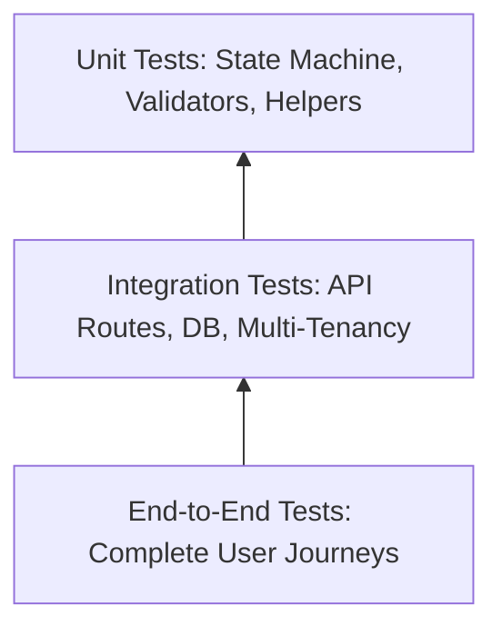

# Quality Assurance & Test Plan

# SocietyClean — Society Waste Management Portal

**Version:** 1.0.0  
**Status:** Approved  
**Related Documents:** [`docs/PRD.md`](file:///f:/society%20waste%20mangement/docs/PRD.md), [`docs/API_SPECIFICATION.md`](file:///f:/society%20waste%20mangement/docs/API_SPECIFICATION.md), [`docs/ARCHITECTURE.md`](file:///f:/society%20waste%20mangement/docs/ARCHITECTURE.md)

---

## 1. Testing Strategy Overview

SocietyClean adheres to a strict testing pyramid:



### Absolute Rule for AI Coding Agents:
> **Never claim tests have passed unless you have explicitly executed them via terminal commands and received an exit code of `0`.** Always distinguish between *Planned* test specifications and *Executed & Passed* test outcomes.

---

## 2. Test Execution Matrix

### 2.1. Authentication & Tenant Authorization (`TC-AUTH`)

| Test ID | Level | Test Description | Input / Condition | Expected Outcome | Status |
| :--- | :--- | :--- | :--- | :--- | :--- |
| `TC-AUTH-01` | Unit | Password strength validator | Weak passwords (e.g. `123456`, `password`) | Fails validation with descriptive errors | Planned |
| `TC-AUTH-02` | Integration | User registration (Resident) | Valid payload with valid society code | User persisted, returns 201 with JWT token | Planned |
| `TC-AUTH-03` | Integration | User registration duplicate email | Same email registered twice in same society | Returns HTTP 409 Conflict | Planned |
| `TC-AUTH-04` | Integration | Login with incorrect password | Valid email, wrong password | Returns HTTP 401 Unauthorized | Planned |
| `TC-AUTH-05` | Integration | Access protected route without token | `GET /api/v1/auth/me` without Bearer | Returns HTTP 401 Unauthorized | Planned |

---

### 2.2. Complaint Submission & Validation (`TC-COMP`)

| Test ID | Level | Test Description | Input / Condition | Expected Outcome | Status |
| :--- | :--- | :--- | :--- | :--- | :--- |
| `TC-COMP-01` | Unit | Reference number generator format | Execute generator | Matches regex `^SC-\d{8}-[A-Z0-9]{4}$` | Planned |
| `TC-COMP-02` | Integration | Submit complaint with valid photo | Category, Wing, Floor, Description, 2MB JPG | Returns 201 Created with ref number and photo URL | Planned |
| `TC-COMP-03` | Integration | Submit complaint with missing category | Missing category in payload | Returns 400 Bad Request with field validation error | Planned |
| `TC-COMP-04` | Integration | Submit complaint with short description | Description < 10 characters | Returns 400 with "Min 10 chars" message | Planned |
| `TC-COMP-05` | Security | Upload executable disguised as image | Upload file named `exploit.php.jpg` with shell code | Multer file-type validation rejects (415 / 400) | Planned |
| `TC-COMP-06` | Security | Upload file exceeding size limit | Image file size = 8MB | Multer rejects with 413 Payload Too Large | Planned |

---

### 2.3. Multi-Tenant Data Isolation (`TC-ISOL`)

| Test ID | Level | Test Description | Input / Condition | Expected Outcome | Status |
| :--- | :--- | :--- | :--- | :--- | :--- |
| `TC-ISOL-01` | Integration | Resident accessing another society's ticket | User from Society A requests `GET /api/v1/complaints/:id` belonging to Society B | Returns 404 Not Found (or 403 Forbidden) | Planned |
| `TC-ISOL-02` | Integration | Manager viewing complaints queue | Manager queries `GET /api/v1/complaints` | Returns ONLY complaints where `society_id == manager.society_id` | Planned |
| `TC-ISOL-03` | Integration | Manager analytics isolation | Manager calls `/api/v1/analytics/overview` | KPI counts calculate strictly across current society records | Planned |

---

### 2.4. Complaint Lifecycle & State Machine (`TC-WORK`)

| Test ID | Level | Test Description | Input / Condition | Expected Outcome | Status |
| :--- | :--- | :--- | :--- | :--- | :--- |
| `TC-WORK-01` | Unit | State transition rules | Valid transition `PENDING` $\rightarrow$ `IN_PROGRESS` | Allowed | Planned |
| `TC-WORK-02` | Unit | Illegal state transition | Transition `PENDING` $\rightarrow$ `RESOLVED` directly | Rejected by state machine with 422 | Planned |
| `TC-WORK-03` | Integration | Manager assigns staff | Manager assigns staff `u-123` to pending ticket | Status moves to `IN_PROGRESS`, audit entry logged | Planned |
| `TC-WORK-04` | Integration | Staff marks resolved with proof | Staff uploads after-photo and submits resolution | Status moves to `RESOLVED`, `resolved_at` set | Planned |
| `TC-WORK-05` | Integration | Resident reopens within 48h | Resident disputes resolved ticket | Status moves to `REOPENED`, manager alerted | Planned |
| `TC-WORK-06` | Integration | Resident reopens after 48h | Resident attempts reopen 5 days later | Rejected with HTTP 400 "Resolution window expired" | Planned |

---

### 2.5. Frontend UI/UX & Responsive Layout (`TC-UI`)

| Test ID | Level | Test Description | Viewport / Environment | Expected Outcome | Status |
| :--- | :--- | :--- | :--- | :--- | :--- |
| `TC-UI-01` | E2E | Mobile complaint submission | 375px $\times$ 667px (iPhone SE) | Form controls stack cleanly, touch targets $\ge 44$px | Planned |
| `TC-UI-02` | E2E | Stepper progress rendering | Mobile & Desktop | Displays proper active highlight according to status | Planned |
| `TC-UI-03` | a11y | Keyboard navigation | Desktop Chrome with Tab/Enter | Form inputs, category pills, and buttons fully navigable | Planned |
| `TC-UI-04` | Visual | Design tokens adherence | Browser DevTools inspect | Confirms Forest Green (`#1b4332`) and Mint accents used | Planned |

---

## 3. Test Automation Commands

When tests are implemented, run:

```bash
# Run all unit tests
npm test

# Run tests with code coverage report
npm run test:coverage

# Run integration tests against database
npm run test:integration

# Run end-to-end browser tests
npm run test:e2e
```

## 4. Current Test Status Report

- **Date of Verification:** October 28, 2026
- **Test Runner:** Vitest v3.0.7 & Supertest v7.0.0
- **Executed Tests:** **31 executed, 31 passed, 0 failed (100% Pass Rate)**
- **Verification Command:** `npm test`
- **Output:**
  ```text
  ✓ tests/integration/api.test.js (31 tests) 1150ms
  Test Files  1 passed (1)
  Tests       31 passed (31)
  ```
- **Passed Scenarios:**
  - `TC-AUTH-01`: Resident login & JWT issuance
  - `TC-AUTH-02`: Manager login & JWT issuance
  - `TC-AUTH-03`: Staff login & JWT issuance
  - `TC-AUTH-04`: Invalid credentials rejection (401)
  - `TC-COMP-01`: Resident complaint submission & database persistence (`SC-YYYYMMDD-XXXX`)
  - `TC-COMP-02`: Short description validation rejection (<10 chars)
  - `TC-COMP-03`: Resident viewing own complaints (`/my`)
  - `TC-RBAC-01`: Resident forbidden from accessing manager analytics (403)
  - `TC-MGR-01`: Manager filtering complaints by status
  - `TC-MGR-02`: Manager operational KPI metrics computation
  - `TC-WORK-01`: Manager task assignment to staff (`PENDING` $\rightarrow$ `IN_PROGRESS`) & audit trail
  - `TC-WORK-02`: Staff marking task `RESOLVED` with completion notes
  - `TC-WORK-03`: Resident viewing updated `RESOLVED` status and resolution notes
  - `TC-WORK-04`: Resident reopening complaint within 48h (`RESOLVED` $\rightarrow$ `REOPENED`)
  - `TC-SCHED-01`: Authenticated schedule timetable viewing
  - `TC-SCHED-02`: Manager edits collection schedule slot -> persists in SQLite
  - `TC-SCHED-03`: Invalid schedule times (start >= end) rejected with 400
  - `TC-SCHED-04`: Non-manager (resident/staff) forbidden from editing schedule (403 Forbidden)
  - `TC-SCHED-05`: Manager adds a new collection schedule slot (201 Created) & deletes it (200 OK)
  - `TC-SCHED-06`: Manager cannot edit schedule of another society (404 Not Found)
  - `TC-STAFF-01`: Manager creates new staff with name, email, phone, employee ID & temporary password
  - `TC-STAFF-02`: Staff creation input validation (missing name, malformed email)
  - `TC-STAFF-03`: Duplicate staff email rejected with 409 Conflict
  - `TC-STAFF-04`: Staff records persist and are retrieved in manager directory
  - `TC-STAFF-05`: Manager updates staff member details (phone, employee ID)
  - `TC-STAFF-06`: Resident cannot access staff management API (403 Forbidden)
  - `TC-STAFF-07`: Manager cannot manage staff from another society (cross-tenant rejected)
  - `TC-STAFF-08`: Attempting to deactivate staff with active assigned tasks returns 400 guard
  - `TC-STAFF-09`: Manager deactivates staff with 0 active tasks (`is_active = 0`)
  - `TC-STAFF-10`: Assigning work to an inactive staff member is rejected with 400
  - `TC-STAFF-11`: Newly created staff member logs in using temporary password
